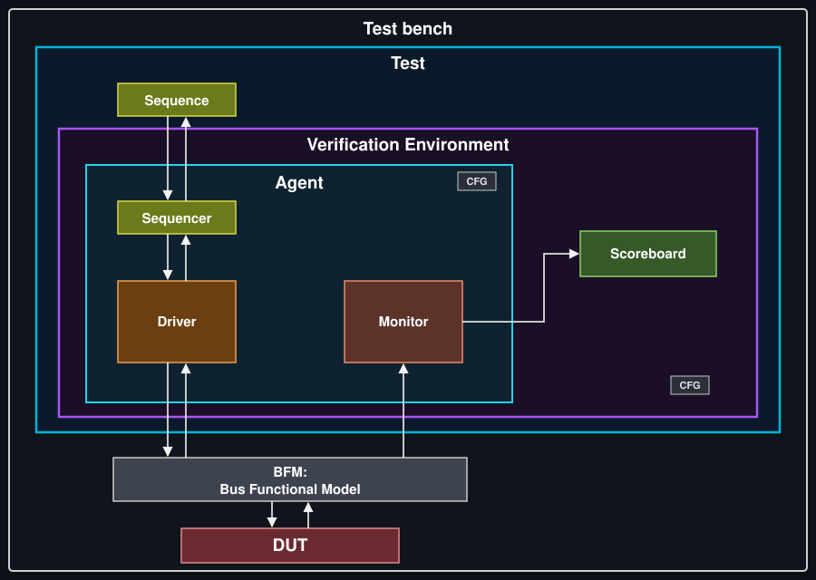

# pyuvm Testbench for a Registered Comparator

A small but complete UVM-style testbench written in Python with [pyuvm](https://github.com/pyuvm/pyuvm) and [cocotb](https://www.cocotb.org/). The DUT is a 2-bit registered comparator. I built this to practice the full UVM structure (item, sequence, sequencer, driver, monitor, scoreboard, agent, env, test) without needing SystemVerilog UVM.

## The DUT

`comparator.sv` compares two `WIDTH`-bit inputs and registers three flags:

| Output | Meaning |
|--------|---------|
| `eq`   | `a == b` |
| `gt`   | `a > b`  |
| `lt`   | `a < b`  |

- The outputs update on the rising clock edge, so the result has one cycle of latency.
- Reset (`rst_n`) is asynchronous and active low. While it is low, all three flags are 0.
- `WIDTH` defaults to 2.

## Testbench architecture

<p align="center">
  
</p>

| File | What it does |
|------|--------------|
| `intf.py` | `ComparatorBfm`: wraps the DUT signals, sets safe defaults, and starts the 10 ns clock. |
| `tb_env.py` | All UVM components, sequences and tests. |
| `comparator.sv` | The DUT. |
| `Makefile` | Runs the simulation through cocotb's makefiles. |

### How the pieces work

- **Driver** gets an item, waits for a falling edge, drives `rst_n`, `a` and `b`, then waits for the next rising edge before calling `item_done()`. Driving on the falling edge keeps the inputs stable around the sampling edge.
- **Monitor** waits for a rising edge, then enters the `ReadOnly` phase so the registered outputs have settled. It samples inputs and outputs together and sends them to the scoreboard.
- **Scoreboard** computes the expected `eq`/`gt`/`lt` from the sampled inputs and compares. Any mismatch is stored. `check_phase` fails the test if there were mismatches, or if nothing was observed at all (this stops an empty test from passing silently).
- **Base test** applies a reset sequence first, then calls `run_sequence()`, which each concrete test overrides.

## Tests

| Test | What it checks |
|------|----------------|
| `equal_test`   | Random value on `a`, with `b` set equal to it. |
| `greater_test` | `a=3`, `b=1`. |
| `less_test`    | `a=1`, `b=3`. |
| `random_test`  | 30 random `(a, b)` pairs. |

All four tests pass in my last run (see `results.xml`).

## Running it

### Requirements

- Python 3.9+
- cocotb 2.0 or newer
- pyuvm
- A simulator supported by cocotb. The Makefile uses **Questa** by default.

```bash
pip install -r requirements.txt
```

### Commands

```bash
make                         # run all tests
make TESTCASE=random_test    # run one test
make SIM=icarus              # use another simulator
make COVERAGE=1              # also produce a Python coverage report
make clean                   # remove generated files
```

With `COVERAGE=1`, an HTML report is written to `htmlcov/index.html`. This needs the `coverage` package.

Waveforms are enabled by default (`WAVES = 1` in the Makefile).

## Project layout

```
.
├── comparator.sv
├── intf.py
├── tb_env.py
├── Makefile
├── architecture.svg
├── requirements.txt
├── results.xml
└── README.md
```

## Ideas for next steps

- Add functional coverage for the `(a, b)` input space. With `WIDTH = 2` there are only 16 combinations, so full coverage is easy to reach.
- Run the testbench with a larger `WIDTH`.
- Add a test that asserts reset in the middle of traffic, to check the asynchronous reset path.

## Author

**Khaled Ahmed Hamed**
Electronics and Communications Engineering, Cairo University
